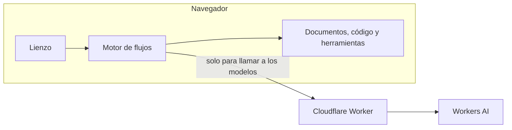

# Telar

Constructor visual de agentes de IA. Arrastrás bloques a un lienzo, los conectás y ejecutás el agente con modelos reales, sin registrarte.

**[Probar la demo](https://telar.fsucatti-portfolio.workers.dev)**


Diseño de **Julian Sucatti**. Desarrollo de **Francisco Sucatti**.

## Primeros pasos

La forma más rápida es partir de una plantilla:

1. En la pantalla inicial, elegí **Assistant with tools**.
2. Apretá **Playground**, arriba a la derecha.
3. Elegí una de las preguntas sugeridas o escribí la tuya.

Mientras corre, cada bloque se ilumina en el lienzo y la respuesta aparece a medida que se escribe. Abrí **steps** sobre la respuesta para ver qué hizo cada bloque y cuánto tardó.

### Plantillas

| Plantilla | Qué muestra |
|---|---|
| **Contract analyzer** | Responde desde documentos y procesa la respuesta con código |
| **Job fit reviewer** | Compara una oferta de trabajo con un CV |
| **Support triage** | La IA decide por cuál de dos caminos sigue cada mensaje |
| **Assistant with tools** | Un agente con memoria que usa calculadora, fecha y documentos |
| **Poster maker** | Un modelo escribe el prompt y otro genera la imagen |

Los documentos y datos de las plantillas son inventados.

## Armar tu propio agente

1. Apretá **New blank agent**.
2. Elegí un bloque de la lista izquierda: con un clic se inserta antes de **Output** y queda conectado. También podés arrastrarlo a un lugar del lienzo y conectarlo a mano.
3. Hacé clic en el bloque para configurarlo en el panel derecho.
4. Probalo en **Playground**. Con Enter enviás, y con Shift+Enter hacés un salto de línea.

### Conexiones

Cada bloque recibe texto por arriba y lo entrega por abajo, desde **Input** hasta **Output**. Para conectar, arrastrá desde un punto hasta otro.

**Documents** y **Conversation** son distintos: se conectan al costado izquierdo de un modelo, porque le dan contexto en lugar de pasarle el mensaje.

En los textos de configuración, `{{input}}` se reemplaza por lo que produjo el bloque anterior.

## Bloques

| Bloque | Para qué sirve |
|---|---|
| **Language** | Responde con un modelo de texto. Le definís instrucciones, modelo, creatividad y largo de la respuesta |
| **Agent** | Un modelo que decide cuándo usar sus herramientas: calculadora, fecha y hora, y búsqueda en documentos |
| **Image generation** | Genera una imagen a partir de un texto |
| **Documents** | Busca en tus archivos los pasajes relevantes para cada pregunta y se los pasa al modelo |
| **Conversation** | Le permite a un modelo recordar los mensajes anteriores |
| **Condition** | Divide el flujo en un camino Yes y otro No, según un texto, un patrón o una pregunta que responde la IA |
| **Text template** | Combina texto fijo con el resultado del bloque anterior |
| **JavaScript** | Procesa el texto con tu código. Recibe `input` y devuelve el resultado |

Por ejemplo, este bloque de JavaScript cuenta las palabras:

```js
const words = input.trim().split(/\s+/).length;
return `${input}\n\nWords: ${words}`;
```

**Policies**, en la configuración de un modelo, retiene las respuestas que contengan los términos que definas.

## Otras funciones

- **Versiones:** **Create new version** guarda el estado actual, y el selector junto al nombre vuelve a una versión anterior.
- **Compartir:** **Share** copia un enlace. Quien lo abre recibe su propia copia del agente.
- **Deshacer:** con los botones del lienzo, o con Ctrl+Z y Ctrl+Y.
- **Overview:** muestra la descripción, las versiones y las últimas ejecuciones.
- **Celular:** funciona en pantallas chicas, con el botón **Add block**.

## Cómo funciona



El agente se ejecuta en tu navegador. El motor ordena los bloques según sus conexiones, los corre uno por uno, y omite los que quedan en un camino que la condición no eligió. Solo los bloques que usan un modelo llaman al servidor, que valida el pedido y consulta a [Workers AI](https://developers.cloudflare.com/workers-ai/).

- **Búsqueda en documentos:** divide los archivos en pasajes y los ordena por relevancia con BM25, sin base de datos.
- **Herramientas:** el modelo pide una herramienta, el navegador la ejecuta y le devuelve el resultado, hasta que el modelo puede responder.
- **Código:** corre en un Web Worker aislado, sin acceso a la página ni a la red, y se corta a los 3 segundos.

**Tecnologías:** React, TypeScript, React Flow, Zustand, Vite, Cloudflare Workers y Workers AI.

## Tus datos

- Los agentes y documentos se guardan solo en tu navegador. No hay cuentas, y si borrás los datos del navegador se pierden.
- Al ejecutar, los modelos reciben tu mensaje, las instrucciones del bloque y los pasajes relevantes de tus documentos, a través de Cloudflare.
- Un enlace de **Share** incluye los documentos completos del agente. Tenelo en cuenta antes de compartirlo.

## Límites de la demo

- **Cuota diaria:** la IA real tiene una cuota gratuita compartida, que se renueva a las 00:00 UTC. Si se agota, podés seguir con **Simulated answers**, que prueba el flujo sin usar IA.
- **Por minuto:** hay un máximo de pedidos por visitante. Si lo alcanzás, esperá un minuto.
- **Documentos:** solo archivos de texto (`.txt`, `.md`, `.csv`, `.json`, `.html`) de hasta 300 KB. Todavía no lee PDF.
- **Velocidad:** una respuesta suele tardar unos segundos, aunque puede demorarse más cuando los modelos tienen mucha carga.

## Correrlo en tu computadora

Necesitás Node.js 22 o superior y una cuenta gratuita de Cloudflare, para acceder a los modelos.

```bash
npm install
```

```bash
npx wrangler login
```

```bash
npm run preview
```

Abre <http://localhost:8787>. Las llamadas a la IA descuentan de la cuota de tu cuenta.

| Comando | Qué hace |
|---|---|
| `npm test` | Pruebas del motor |
| `npm run test:e2e` | Pruebas en el navegador, con la IA simulada. En Windows usan Microsoft Edge |
| `npm run deploy` | Publica en tu cuenta de Cloudflare |

Para sumar bloques, modelos o plantillas, mirá [cómo personalizar Telar](docs/PERSONALIZAR.md).
