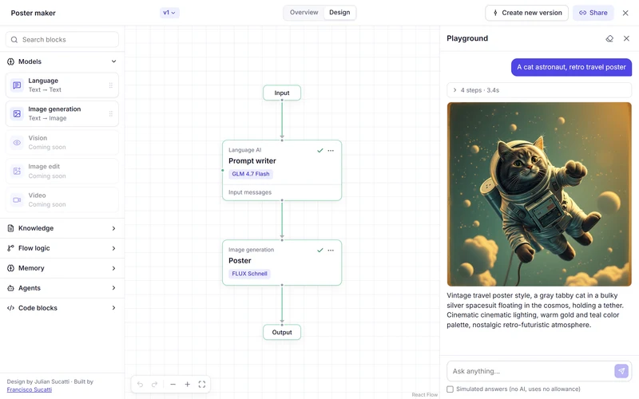

# Telar

A visual AI agent builder. Drag blocks onto a canvas, connect them, and run the agent with real models. No sign-up needed.

**[Try the demo](https://telar.fsucatti-portfolio.workers.dev)**



Design by **Julian Sucatti**. Built by **Francisco Sucatti**.

## Getting started

The quickest way in is a template:

1. On the home screen, choose **Assistant with tools**.
2. Click **Playground** at the top right.
3. Pick a suggested question or type your own.

During a run, each block lights up on the canvas and the answer appears as it's written. Expand **steps** above the answer to see what each block did and how long it took.

### Templates

| Template | What it shows |
|---|---|
| **Contract analyzer** | Answers from documents and processes the answer with code |
| **Job fit reviewer** | Compares a job posting with a resume |
| **Support triage** | AI decides which of two paths each message takes |
| **Assistant with tools** | An agent with memory that uses a calculator, the date and documents |
| **Poster maker** | One model writes the prompt and another generates the image |

The documents and data in the templates are made up.

## Build your own agent

1. Click **New blank agent**.
2. Choose a block from the left list. A click inserts it before **Output**, already connected. You can also drag it to a spot on the canvas and connect it by hand.
3. Click the block to configure it in the right panel.
4. Try it in **Playground**. Enter sends, and Shift+Enter adds a line break.

### Connections

Each block takes text in at the top and passes it on from the bottom, from **Input** through to **Output**. To connect two blocks, drag from one point to another.

**Documents** and **Conversation** work differently. They connect to the left side of a model, because they give it context instead of passing it the message.

In a block's settings, `{{input}}` is replaced by what the previous block produced.

## Blocks

| Block | What it does |
|---|---|
| **Language** | Answers with a text model. You set its instructions, model, creativity and answer length |
| **Agent** | A model that decides when to use its tools: calculator, date and time, and document search |
| **Image generation** | Generates an image from text |
| **Documents** | Finds the passages in your files that are relevant to each question and gives them to the model |
| **Conversation** | Lets a model remember earlier messages |
| **Condition** | Splits the flow into a Yes path and a No path, based on text, a pattern or a question that AI answers |
| **Text template** | Combines fixed text with the previous block's result |
| **JavaScript** | Processes text with your code. It receives `input` and returns the result |

For example, this JavaScript block counts words:

```js
const words = input.trim().split(/\s+/).length;
return `${input}\n\nWords: ${words}`;
```

**Policies**, in a model's settings, withholds any answer that contains terms you define.

## Other features

- **Versions:** **Create new version** saves the current state, and the selector next to the name goes back to an earlier one.
- **Sharing:** **Share** copies a link. Whoever opens it gets their own copy of the agent.
- **Undo:** use the buttons on the canvas, or Ctrl+Z and Ctrl+Y.
- **Overview:** shows the description, versions and recent runs.
- **Phones:** it works on small screens, through the **Add block** button.

## How it works

The agent runs in your browser. Blocks run one at a time, following their connections, and blocks that use a model call [Workers AI](https://developers.cloudflare.com/workers-ai/).

**Built with:** React, TypeScript, React Flow, Zustand, Vite, Cloudflare Workers and Workers AI.

## Your data

- Agents and documents are saved only in your browser. There are no accounts, and clearing your browser data deletes them.
- During a run, models receive your message, the block's instructions and the relevant passages from your documents, through Cloudflare.
- A **Share** link includes the agent's full documents, so check them before you share it.

## Demo limits

- **Usage:** the demo has usage limits. If you reach one, try again later, or keep going with **Simulated answers**, which tests the flow without using AI.
- **Documents:** text files only (`.txt`, `.md`, `.csv`, `.json`, `.html`), up to 300 KB each. PDF isn't supported yet.
- **Speed:** an answer usually takes a few seconds, and can take longer when the models are busy.

## Run it locally

You need Node.js 22 or later and a free Cloudflare account, which gives access to the models.

```bash
npm install
```

```bash
npx wrangler login
```

```bash
npm run preview
```

Then open <http://localhost:8787>. AI calls count against your account's allowance.

| Command | What it does |
|---|---|
| `npm test` | Tests the engine |
| `npm run test:e2e` | Tests in the browser, with AI simulated. On Windows these use Microsoft Edge |

To add blocks, models or templates, see [how to customize Telar](docs/CUSTOMIZING.md).
